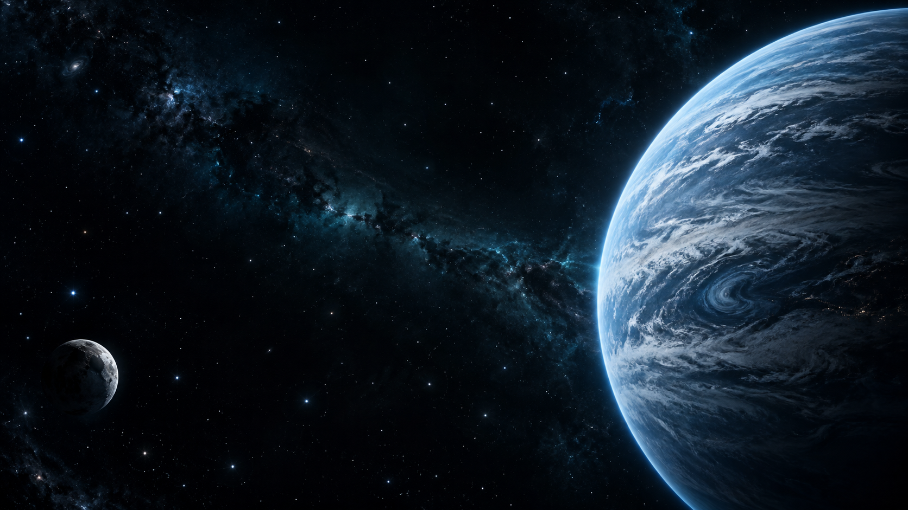

# Yörünge

<div align="center">



### Her çalışma seansı, kendi yörüngeni kurar.

Türkçe arayüzlü, uzay temalı bir Pomodoro deneyimi. Dersini ve konunu kendin yaz; odağını başlat, ilerlemeni gökyüzünde izle.

<br />

**React · TypeScript · Vite · WebGL · Ücretsiz**

</div>

---

## Proje hakkında

Yörünge; kısa çalışma seanslarını daha düzenli ve keyifli hale getirmek için tasarlanmış bir odak uygulamasıdır. Sade bir zamanlayıcıyı, kişisel çalışma istatistiklerini ve üç boyutlu bir gökyüzü deneyimini bir araya getirir. Havacılık ve uzaydan ilham alan ufak mesajlar arayüzde yol arkadaşlığı eder; çalışma alanı ise her bölümden üniversite öğrencisinin kendi ders ve konu adlarını girebileceği şekilde açıktır.

## Öne çıkanlar

| Alan | Deneyim |
| --- | --- |
| **Odak** | Pomodoro ve kronometre, duraklatma/devam, süre ayarı ve isteğe bağlı bildirimler |
| **Kişisel çalışma alanı** | Ders, konu ve çalışma hedefini serbestçe yazma |
| **İlerleme** | Seans geçmişi, haftalık odak görünümü, seri, rozetler ve çalışma ısı haritası |
| **Gökyüzüm** | WebGL ile çizilen, etkileşimli dönen gezegen ve kişisel yıldız haritası |
| **Üyelik ve istasyonlar** | Hesap oluşturma, giriş, arkadaşlık isteği, dürtme ve hesaplar arasında sohbet |
| **Kişiselleştirme** | Beş tema, mobil uyumlu sayfalar ve isteğe bağlı ambiyans sesi |

## Ekranlar

- **Ana sayfa:** günün odağına hızlıca başla.
- **Zamanlayıcı:** çalışma ve mola seanslarını yönet.
- **İstasyonlar:** arkadaş ve sohbet deneyimine ayrılmış alanı keşfet.
- **Gökyüzüm:** üç boyutlu gezegen sahnesinde çalışma yolculuğunu gör.
- **Profil:** seanslarından oluşan kişisel ilerlemeni incele.

## Yerelde çalıştırma

### Gereksinimler

- Node.js 20 veya üzeri
- npm

### Kurulum

```bash
git clone https://github.com/BurkaX-0/yorunge-atlas.git
cd yorunge-atlas
npm ci
npm run dev
```

Vite geliştirme sunucusunun adresi terminalde görünür; genellikle `http://localhost:5173` olur.

Üretim derlemesini oluşturmak ve yerelde önizlemek için:

```bash
npm run build
npm run preview
```

## Teknoloji

- **React 18** ve **TypeScript** — kullanıcı arayüzü
- **Vite** — geliştirme ve üretim derlemesi
- **WebGL** — etkileşimli uzay sahnesi
- **Framer Motion** — arayüz hareketleri
- **Lucide** — arayüz simgeleri

## Veri ve güvenlik

Hesaplar, kullanıcı adı eşlemesi, oturumlar, arkadaşlık istekleri, dürtmeler ve sohbet mesajları Vercel sunucu işlevleri üzerinden Upstash Redis’te tutulur. Parolalar sunucu tarafında scrypt ile özetlenir; tarayıcıya yalnızca `HttpOnly`, `SameSite=Lax` oturum çerezi verilir. API oturum gerektirir, kullanıcı girdilerini sınırlar ve temel istek hız sınırlarını uygular. Upstash erişim bilgileri sadece Vercel ortam değişkenlerinde bulunur; kaynak koduna eklenmez.

Pomodoro tercihleri ve bireysel çalışma geçmişi şu an tarayıcının yerel deposunda kalır; bu veriler farklı cihazlar arasında eşitlenmez. Çevrimiçi hesap ve sosyal özellikler için Vercel’de Upstash entegrasyonu kurulmuş olmalıdır. Uygulama `UPSTASH_REDIS_REST_URL` / `UPSTASH_REDIS_REST_TOKEN` veya `KV_REST_API_URL` / `KV_REST_API_TOKEN` değişkenlerini kullanır. Ücretsiz Upstash planı aşılırsa sağlayıcı kota sınırları uygulanabilir; ücretli plana otomatik geçiş yapılandırılmamıştır.

## Görsel kaynakları

Uzay panoraması bu proje için özgün olarak üretildi. Diğer sahne ayrıntıları uygulama içindeki SVG ve WebGL çizimlerinden oluşur. Daha fazla bilgi için [CREDITS.md](CREDITS.md) dosyasına bak.

## Katkı ve lisans

Öneri veya hata bildirimi için GitHub Issues kullanabilirsin. Depo herkese açık olsa da henüz bir açık kaynak lisansı eklenmemiştir; açık bir lisans eklenene kadar kodun yeniden kullanım hakları saklıdır.
